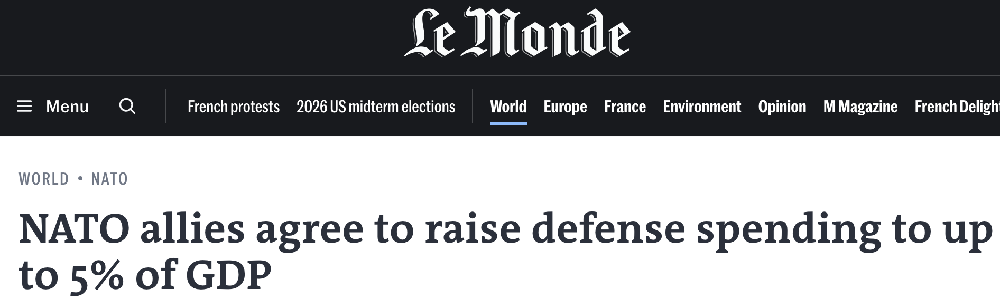
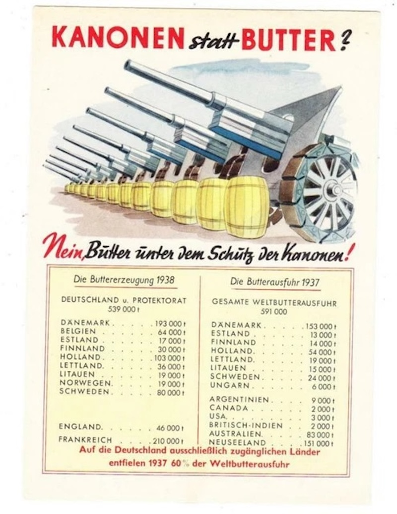
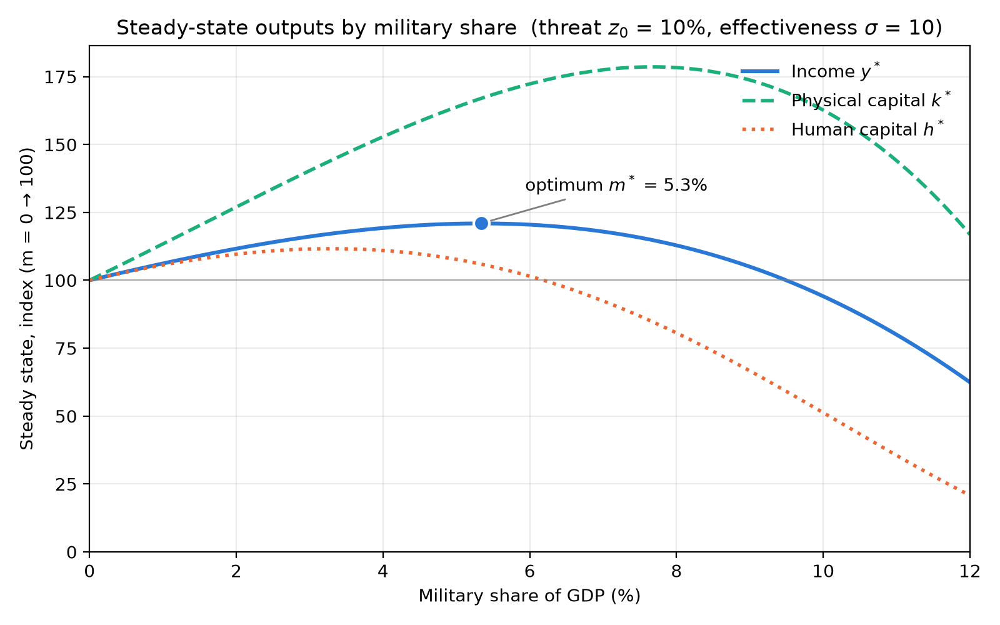

# Motivation

=> 

---

\

> **The cost of one modern heavy bomber is this: a modern brick school in more than 30 cities**. It is two electric power plants, each serving a town of 60,000 population. It is two fine, fully equipped hospitals. It is some fifty miles of concrete pavement.
>
> ~ **Dwight Eisenhower:** "Chance for Peace" 1953

:::: {.columns}

::: {.column width="50%"}

:::

::: {.column width="50%"}

:::

::::

# Model

normal MRW-type Solow

$$
Y = K^\alpha H^\beta L^{1-\alpha-\beta}
$$

State Sector

- fixed tax share $tY$
  - spent either on education or military
  - $t = e+m$

# Role of the Military

higher m =>  deterrence / protection

- physical capital (destruction)
- human capital (loss of life)

$$
z(m) = z_0  e^{-\sigma m}
$$

- $z_0$ = expected war loss (without any military)
  - chance of war * expected destruction
- $e^{-\sigma m}$  = deterrence effect
  - $\sigma$ = effectiveness of military spending
- $z'(m) < 0$ = decreasing losses
- $z''(m) > 0$ = diminishing returns

# Laws of Motion

Now: 
$$
\dot{k} = \overbrace{s(1-t)y}^{\text{investment}} 
- \overbrace{(n+d)k}^{\text{depreciation}} 
- \overbrace{z(m)k}^{\text{destruction}} 
$$

$$
\dot{h} = (t-m)y - (n+d)h - z(m)h
$$

Simplification: $D(m) = (n+d+z(m))$

# Steady State

Let $\dot{k}=0$ and $\dot{h}=0$, then
$$
k^* = \frac{s(1-t)}{D(m)}y
$$

$$
h^* = \frac{(t-m)}{D(m)}y
$$

Subst in $y = k^{\alpha} h^\beta$
$$
y^* = \{[s(1-t)]^\alpha [t-m]^\beta D(m)^{-(\alpha+\beta)} \}^{1/1-\alpha-\beta}
$$

# Solve

Optimum
$$
\overbrace{
\frac{(\alpha+\beta)\sigma z(m)}{n+d+z(m)}
}^{\text{Marginal Benefit}} 
=
\overbrace{\frac{\beta}{(t-m)}}^{\text{Marginal Cost}}
$$
LHS = Marginal Benefit of tanks

- Numerator: both capital shares 
- Denominator: the D

RHS = Marginal Cost

- Numerator: importance of human capital
- Denominator: share spent on education

$m^* > 0$ if $MB > MC$

# Numerical Example

Illustrative example (because the maths is too complicated)

- $\alpha = \beta = 1/3$
- $n+d = 0.05$
- $t = 0.146$ => 14.68%  world average tax revenue ([World Bank](https://en.wikipedia.org/wiki/List_of_countries_by_tax_revenue))
- $\sigma = 10$ (1 is never enough)

| Threat z0 (%) | Optimal military share m* (% GDP) | Education spending (% GDP) | Income gain vs m = 0 (%) |
| ------------: | --------------------------------: | -------------------------: | -----------------------: |
|           0.0 |                              0.00 |                      14.68 |                      0.0 |
|           5.0 |                              2.96 |                      11.72 |                      5.0 |
|          10.0 |                              5.39 |                       9.29 |                     21.3 |
|          20.0 |                              7.13 |                       7.55 |                     46.7 |

# Plots

# Policy

Why do countries spend different amounts on military?

- different perceived war risk $z_0$
- higher / lower effectiveness $\sigma$ (e.g nuclear bomb)

= different political attitudes etc

**Note:** Assumptions, Rationality, Functional Form

\

> Every gun that is made, every warship launched, every rocket fired signifies, in the final sense, a theft from those who hunger and are not fed, those who are cold and are not clothed.
>
> **~ Dwight Eisenhower**: "Chance for Peace" 1953 

