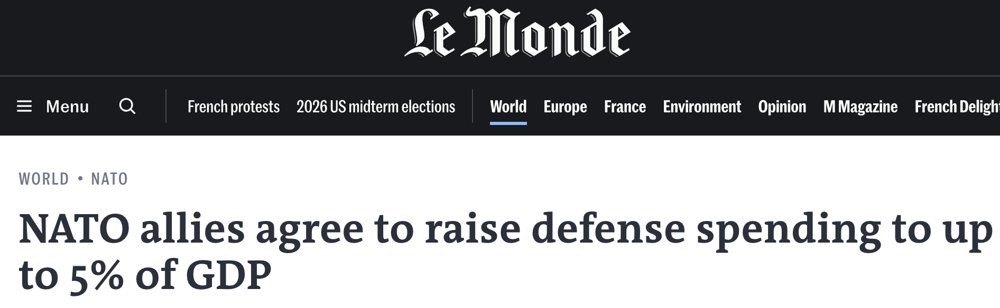
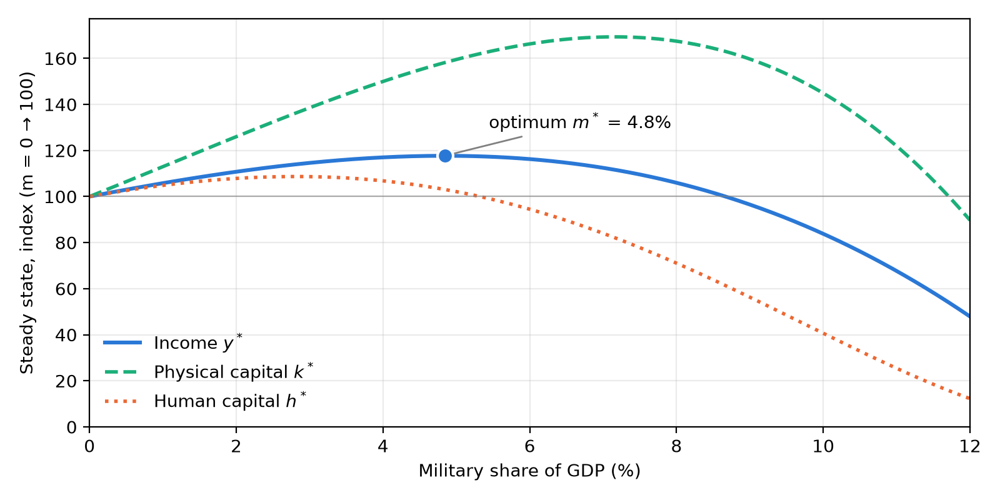

# Motivation

## Motivation

=> 

---

{width=80% fig-align=center}

> **The cost of one modern heavy bomber is this: a modern brick school in more than 30 cities**. It is two electric power plants, each serving a town of 60,000 population. It is two fine, fully equipped hospitals. It is some fifty miles of concrete pavement.
>
> _~Dwight D. Eisenhower: "Chance for Peace" 1953_

# Model

normal MRW-type Solow

$$
Y = K^\alpha H^\beta L^{1-\alpha-\beta}
$$

Government Setors

- collects a fixed tax share $tY$
- spent either on education or military
  - $t = e+m$
  - e => 100% into human capital formation
  - m => spent on military
- m = neither productive nor consumption good 

## Role of the Military

higher m =>  deterrence / protection

- physical capital (destruction)
- human capital (loss of life)

$$
z(m) = z_0  e^{-\sigma m}
$$

- $z_0$ = expected war loss (without any military)
  - chance of war * expected destruction
- $e^{-\sigma m}$  = deterrence effect
  - $\sigma$ = effectiveness of military spending (think: nuclear bomb)
- $z'(m) < 0$ = decreasing losses
- $z''(m) > 0$ = diminishing returns

## Laws of Motion

Now: 
$$
\dot{k} = \overbrace{s(1-t)y}^{\text{investment}} 
- \overbrace{(n+d)k}^{\text{depreciation}} 
- \overbrace{z(m)k}^{\text{destruction}} 
$$

$$
\dot{h} = (t-m)y - (n+d)h - z(m)h
$$

Simplification: $D(m) = (n+d+z(m))$

## Steady State

Let $\dot{k}=0$ and $\dot{h}=0$, then
$$
k^* = \frac{s(1-t)}{D(m)}y
$$

$$
h^* = \frac{(t-m)}{D(m)}y
$$

Subst in $y = k^{\alpha} h^\beta$
$$
y^* = \bigg(\frac{[s(1-t)]^\alpha [t-m]^\beta}{ D(m)^{(\alpha+\beta)}} \bigg)^{1/1-\alpha-\beta}
$$

## Math

Only parts that are relevant:

$$
f(m) \equiv \overbrace{[t-m]^\beta}^f \overbrace{D(m)^{-(a+b)}}^g
$$

Product Rule

$$
\overbrace{-\beta[t-m]^{\beta-1}}^{f'} \cdot \overbrace{D(m)^{-(a+b)}}^{g} + \overbrace{[t-m]^{\beta}}^{f} \cdot \overbrace{-(\alpha+\beta) D(m)^{-(a+b)-1}D'}^{g'} 
$$

Set $f'(m) = 0$

$$
-(\alpha+\beta)D(m)^{-(\alpha+\beta)-1}D'(m)(t-m)^{\beta} = \beta[t-m]^{\beta-1}D(m)^{-(\alpha+b)}
$$

---

Divide by $(t-m)^{\beta-1} D^{-(\alpha+\beta)-1}$

$$
-(\alpha+\beta)(t-m)D'(m)= \beta D(m)
$$

Rearrange

$$
\frac{-(\alpha+\beta)D'(m)}{D(m)} = \frac{\beta}{(t-m)}
$$

And then substituting $D'(m) = -\sigma z(m)$ and $D(m)$, gives the final

# Optimum

## Optimum

$$
\overbrace{
(\alpha+\beta)\sigma\frac{ z(m)}{n+d+z(m)}
}^{\text{Marginal Benefit}} 
=
\overbrace{\frac{\beta}{(t-m)}}^{\text{Marginal Cost}}
$$
LHS = Marginal Benefit of tanks

- Output elasticity of both capitals
- share of war risk in total depreciation 

RHS = Marginal Cost

- Numerator: importance of human capital
- Denominator: share spent on education

$m^* > 0$ if $MB > MC$

## Numerical Example

Illustrative example (because the maths is too complicated)

- $\alpha = \beta = 1/3$
- $n+d = 0.05$
- $t = 0.139$ => world average tax revenue ([World Bank](https://data.worldbank.org/indicator/GC.TAX.TOTL.GD.ZS))
- $\sigma = 10$ (1 is never enough)

| z_0 (%) | Optimal military share m* (% GDP) | Education spending (% GDP) | Income gain vs m = 0 (%) |
| ------: | --------------------------------: | -------------------------: | -----------------------: |
|       0 |                                 0 |                       13.9 |                        0 |
|       5 |                              2.49 |                      11.41 |                      3.7 |
|      10 |                              4.84 |                       9.06 |                     17.7 |
|      20 |                               6.5 |                        7.4 |                     39.6 |

## Plot

## Discussion

Why do countries spend different amounts on military?

- differing war risk $z_0$
- higher / lower effectiveness $\sigma$ (e.g nuclear bomb)

Politics

- can explain different political attitudes (perception of $z_0$)
- why owners of physical capital lobby for higher m

**Limitations:** Assumptions, Rationality, Functional Form, ... 

> Every gun that is made, every warship launched, every rocket fired signifies, in the final sense, a theft from those who hunger and are not fed, those who are cold and are not clothed.
>
> _~ Dwight D. Eisenhower: "Chance for Peace" 1953_

