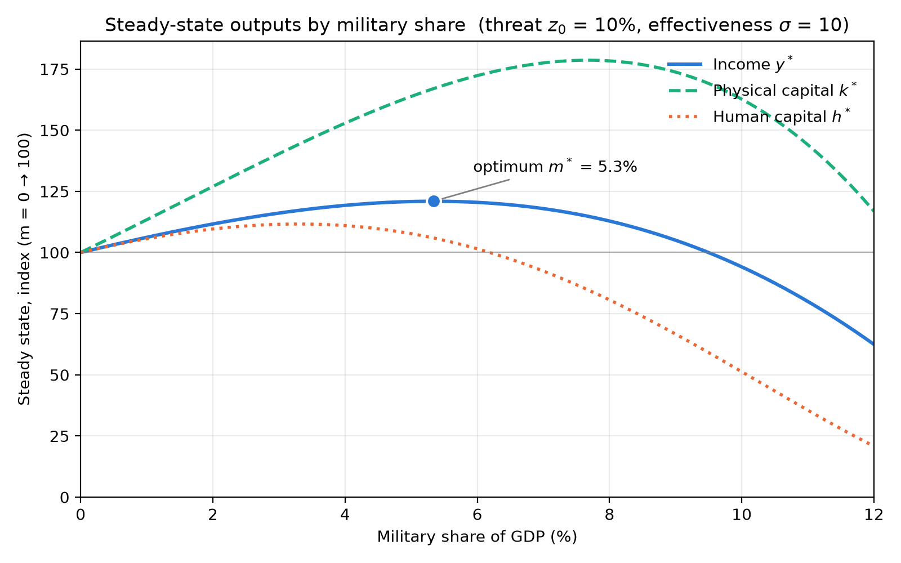

> The cost of one modern heavy bomber is this: a modern brick school in more than 30 cities. It is two electric power plants, each serving a town of 60,000 population. It is two fine, fully equipped hospitals. It is some fifty miles of concrete pavement.
>
> ~ **Dwight Eisenhower:** "Chance for Peace" 1953

- Military spending involves tradeoffs
  - there is no such thing as free lunch
  - opportunity cost
- be it the "guns or butter" debate 
  - @XX
- or even earlier: swords to ploughshares bible
- notion of peace dividend

  - supplanted by: NATO new 5% target

  - in time of limited fiscal budget = repriorities 

=> tradeoff between military spending and other budget factors

- Dwith D. Eisenhower in famous Chance for Peace speech
  - one modern heavy bomber = 30 schools, electric power plants, pavement

- often times: productive investments into education
  - while in the long-term: human capital beneficial for social welfare
  - in the shrot term military logic: 
    - no benefit
    - physical capital and military capital = priority
      - protection
- some Lit (**XX**)
  - miliatry resources
  - deterrence
  - taxation budget

This paper

- model the decision making process
  - between military spending and HC
- in a Solow model
- answer to the question: why do policymakers invest in the military?

## Theoretical Framework

Basic MRW

- Physical Capital
- Human Capital
- Labor
- Technology left outof it, for simplification

$$
Y = K^\alpha H^\beta L^{1-\alpha-\beta}
$$

Government Sector

- takes in fixed tax amount t from economy $tY => (1-t)s$ etc
- either spent on military or education $t = m + e$, and $e,m < t$

Spending on military

- protection role: 
  - physical capital (destruction in case of war)
  - human capital (conscription = not going to school)
- with no military, with a war, there would be higher loss, with a higher military share => lower
- takes away real resources from the economy

We add the term to the laws of motion for per capita physical
$$
\dot{k} = \overbrace{s(1-t)y}^{\text{investment}} - \overbrace{(n+d)k}^{\text{depreciation}} - \overbrace{z(m)k}^{\text{war risk}}
$$
equivalent for human capital
$$
\dot{h} = \overbrace{(t-m)y}^{\text{education spending}} - (n+d)h-z(m)h
$$
both now feature a function that models the war risk

- negatively impacts the buildup of both capital stocks
- requirments for the function
  - higher m => lower value of war risk $z'(m) < 0$
  - but with diminishing returns of miliatry spending
    - intuition: the marginal value of 1000th tank is lower than of the first
    - $z''(m) > 0$
  - $z(0)$ = should be the losses due to war in case of no military spending
    - represent the baseline scenario of what would happen

functional form: very simple e function that fulfills the requirments
$$
z(m) = z_0 e^{-\sigma m}
$$

- $z_0$ = war loss without any military
  - factors influecing this: 
    - perceived chance of war ($\lambda$)
    - expected destruction in case of war ($u$)
    - example: 25% chance of war, 40% destruction 
      - => z0 = 10%
    - not analyzed deeper, subsumed under this
- $e^{-\sigma m}$ = decreasing effect of higher m
  - can be interpreted in two different ways, either
    - deterrence effect = bigger military = lower risk of being attacked
    - protection effect = bigger military = can be better protect if war happens (e.g air defense systems)
- sigma = efficiency of military spending
  - how does increase in military spending reduce risk
  - e.g a nuclear weapon probably has a high deterrence factor 
  - or a very patriot missile air defense system (PATRIOT) = very good protection
  - or in more current terms: highly efficient drones might increase sigma 
    - very money efficient way
    - while other types might be more wasteful

- only one possible functional form
  - but for this modelling exercise = one of the simple versions
  - models policy choices and expectations

## Equilibrium 

Where does the equilibrium of this model land? What are the steady state values k* and h*

- set both equal to zero
- in following math for simplification: D(m) = $(n+d)+z(m)$
  - all factors negatively imacting the capital stocks

Solving physical capital
$$
\dot{k} = s(1-t)y - D(m)k \\
k^* = \frac{s(1-t)}{D(m)}y
$$
identical approach for human capital
$$
h^* = \frac{(t-m)}{D(m)}y
$$
now: the per-capita function
$$
y = \frac{Y}{L} = \frac{K^\alpha H^\beta L^{1-\alpha-\beta}}{L^\alpha L^\beta L^{1-\alpha-\beta}} = k^\alpha h^\beta \\
$$
Substituting eq 5 and 6
$$
y^* = \bigg[\frac{s(1-t)}{D(m)}y^* \bigg]^\alpha \bigg[\frac{(t-m)}{D(m)}y^* \bigg]^\beta \\
$$
simplifies to 
$$
y^* = \{[s(1-t)]^\alpha [t-m]^\beta D(m)^{-(\alpha+\beta)} \}^{1/1-\alpha-\beta}
$$

Now: maximize this over the variable m we can influence $\frac{dy^*}{dm}$

- what is the maximum y we can reach 
- maximize per capital consumption $c = (1-t)(1-s)y$
  - t and s are fixed, not relevant for the maximization

in the function: only take the parts of the bracket dependent on m

- other parts = strictly positive, do not influence the maximum

$$
f(m) \equiv \overbrace{[t-m]^\beta}^f \overbrace{D(m)^{-(a+b)}}^g
$$

Maximum $f'(m)$, with product rule
$$
\overbrace{-\beta[t-m]^{\beta-1}}^{f'} \cdot \overbrace{D(m)^{-(a+b)}}^{g} +
\overbrace{[t-m]^{\beta}}^{f} \cdot \overbrace{-(\alpha+\beta) D(m)^{-(a+b)-1}D'}^{g'} \\
$$
Set $f'(m) = 0$
$$
-(\alpha+\beta)D(m)^{-(\alpha+\beta)-1}D'(m)(t-m)^{\beta} = \beta[t-m]^{\beta-1}D(m)^{-(\alpha+b)}
$$
Divide by $(t-m)^{\beta-1} D^{-(\alpha+\beta)-1}$
$$
-(\alpha+\beta)(t-m)D'(m)= \beta D(m)
$$
Rearrange
$$
\frac{-(\alpha+\beta)D'(m)}{D(m)} = \frac{\beta}{(t-m)}
$$
And then substituting $D'(m) = -\sigma z(m)$ and $D(m)$, gives the final
$$
\overbrace{
\frac{(\alpha+\beta)\sigma z(m)}{n+d+z(m)}
}^{\text{Marginal Benefit}} 
=
\overbrace{\frac{\beta}{(t-m)}}^{\text{Marginal Cost}}
$$
with a very intuitive explanation 

- LHS = Marginal Benefit of higher military spending
  - both capital stocks are protected 
    - dependent on deterrence factor sigma 
  - higher depreciation and war losses reduce the benefit
- RHS = Marginal cost of higher miliatry spending
  - human capital bears the brunt of this
  - higher importance of human capital in economy
    - higher MC
  - and the share spent on education
    - if low, spending on teachers is very useful

Military spending is rational if MB > MC

- condition for interior optimoum: MB(0) > MC(0)
- evalute, treshold value z_0

with $z(0) = z_0$, in eq 15
$$
\frac{(\alpha+\beta)\sigma z_0}{n+d+z_0}
=
\frac{\beta}{t}
$$
Rearringing
$$
(\alpha+\beta)\,\sigma\, t\, z_0 > \beta\,(n+d) + \beta\, z_0 \\
z_0\,\bigl[(\alpha+\beta)\,\sigma\, t - \beta\bigr] > \beta\,(n+d)
$$
Then:
$$
z_0^{crit} = \frac{\beta\,(n+d)}{(\alpha+\beta)\,\sigma\, t - \beta}
$$
War risk has to be above a certain treshold of war risk to be worth it

- below: military spending is always detrimental

## A Numerical Example

To illustrate the model, I now continue with a numerical example

add common factors

- $\alpha = \beta = 1/3$
- $n+d = 0.05$
- a value for fixed tax amount t = 0.146
  - world average tax revenue (@**XX**) World Bank
  - crude simplification, assumption that it is only spent on m and e

### Setting a sigma

18: for z_0 to be between 0 and 1, we need a treshold sigma $\sigma > 3.42$.

- simple version: would be to take sigma = 1: will always give a z_0 that is not feasible
- already one interpretation: simple model never gives any justification for military spending
- for simplicity, I assume sigma = 10, illustrate the workings of the model
- One % increase in m = lowers war risk by about 10% (quite high assumption)

Footnote

Elasticity of z to m
$$
\frac{z(m+\Delta m)}{z(m)} = \frac{z_0\,e^{-\sigma (m+\Delta m)}}{z_0\,e^{-\sigma m}} = e^{-\sigma\,\Delta m} \\
1 - \frac{z(m+\Delta m)}{z(m)} = 1 - e^{-\sigma\,\Delta m}
$$
with sigma=10 and $\Delta m = 0.01 \approx 9.5\%$

### Solving numerically

Solving with these values (Appendix Python Script) yields these values for different z0

| War risk z0 (%) | Optimal military share m* (% GDP) | Education spending (% GDP) | Income gain vs m = 0 (%) |
| --------------: | --------------------------------: | -------------------------: | -----------------------: |
|             0.0 |                              0.00 |                      14.68 |                      0.0 |
|             5.0 |                              2.96 |                      11.72 |                      5.0 |
|            10.0 |                              5.39 |                       9.29 |                     21.3 |
|            20.0 |                              7.13 |                       7.55 |                     46.7 |

As expected:

- higher war risk = shifting resources from education to military
- income gain over zero military spending rises

5.3% = similar to NATO target of 5% military spending

driven by a very high z0

- 10% war risk
  - 25% chance of war in year, 40% destruction
  - for comparison: World Bank estimate of ukraine destruction of physicalcapital (Link)
    - Fall 2022, 6 months after invasion
    - estimate 10% of capital stock to possible already have been destroyed
- frontline states, but even then quite high
- 

### A graphic example

plot this situation (Code in Appendix): 

- military share as dependent variable
- steady state given this m

At toptimum 5,3%:

- the 21.3% income gain over m=0
- human capital = already declining
  - as military spending recudes education spending
  - the protection effort is there for lower ms, maximum reached earlier
- differnt for physical capital
  - maximum at much higher m
  - not impacted as much by higher military spending, only declines later
    - crowding out effect = much later

## Discussion

### Limitations

Only flow variable m

- military spending = could be thought of as building up a stock 
- just including the flow variable = transitions are not modellable

=> does not matter for the steady state analysis

- as stock will be proportional to the flow
- and complicates the model, new law of motion

Disappearance of military spending

- spillover effects of military spending
- and income back to population, eg in the form of soldier pay
- National accounts: 
  - government consumption
  - pay makes up only small share of military expenditure 
  - most into gear and machines
    - without any productive use in the real economy
    - tanks cant make your field

model could be extended 

- a factor of military spending flowing back into consumption
- e.g with w = share of spending that flows back
- would change the magnitude of the equations, but not the direction

And as any neoclassical model

- Assumptions of Rationality
  - that m is a function of measurable inputs
  - and does not follow any other considerations (military industrial complex)

### Politics 

This model: can explain why there are political differences about military spending

- factions opposed to higher military spending = perceive war risk to be lower
- others = in favor of higher military spending

the years of the peace dividend after Cold war

- common politial understanding that risk is quite low
- allows lower military spending m

Investments into modern war equipment 

- raise deterrence factor sigma = raises z
- nuclear bomb = $\sigma \to \infin$
  - deterrence of it is very high, as no one would ever dare to attack

INterest groups that rely on physical capital

- greater incentive to lobby for higher military spending
- as their optimal m is higher than whole society 

## Conclusion

- This approach: looked at how to model a trade off with education spending
  - in a SOlow MRW model
- dependent on war risk, deterrence factor, and tax base variables
- something we see in the current debate in european countries around the NATO target of 5% of GDP spent on military

Optimal militry spending:

- balances marginal cost in form of reduced human capital investment
- with marginal benefit of the protection of both stocks of capital 

Numverical Results show that a value of military target of 5.3%, close to NATO target 

- depends on a high risk of war 
- and a high deterrence factor of the militrary
- at least in this simplified model

The model

- can explain why different countries invest a different share of their GDP in military
- also the  investment in different types of weaponry
- elaborate reasons for different political opinions on military spending

Always shows: tradeoffs are real. As demonstrated by a second fragment from the speech quoted above: 

> Every gun that is made, every warship launched, every rocket fired signifies, in the final sense, a theft from those who hunger and are not fed, those who are cold and are not clothed.
>
> **~ Dwight Eisenhower**: "Chance for Peace" 1953 