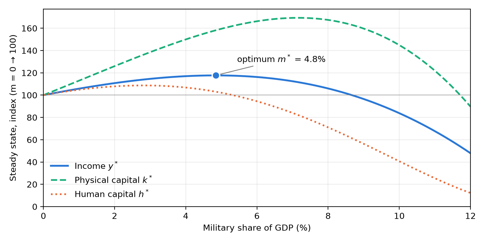



## Theoretical Framework

I start with a basic Solow model with a Cobb-Douglas production function à la @mankiwContributionEmpiricsEconomic1992:

$$
Y = K^\alpha H^\beta L^{1-\alpha-\beta}
$$

with physical capital $K$, human capital $H$, and population $L$. Note that there is no stock for military, as it is assumed to be neither a productive good nor a consumer good and therefore not contribute to the the steady state of the economy. 

There exists a government, that taxes the economy with a fixed amount $\tau$. I model government spending to be either spent on human capital ($e$) or the military ($m$):

$$
G = t Y \text{ with } t = m+e
$$

Spending on the military protects the economy's production factors, e.g from physical destruction or lost human capital due to conscription. Spending more on the military protects better. This can be thought of in two different ways: either as a deterrence, with a larger military reducing the ex-ante risk of war breaking out, or as a better protection ex-post against destruction in case of war (think air-defense systems). 

Therefore, I define a function $z(m)$, that describes this relationship. $z$ can be thought as the "war risk". It has to fulfill three different requirements:

1. A higher spending on military should reduce the war risk: $z'(m) < 0$
2. There are diminishing returns on military spending. The 1000th tank will not provide as much protection as the first one: $z''(m) > 0$
3. In case of no military spending, the war risk should represent the expected losses that a war would cause ($z(0) = z_0$). This can be thought of as a combination of the 2 factors mentioned above: the "natural risk of war" ex-ante, as well as the expected destruction in case of war ex-post. It is irrelevant, which of these 2 factors have a bigger impact; $z_0$ will be treated as a black box.

A very simple functional form to fulfill these requirements is the following exponential function: 

$$
\boxed{
z(m) = z_0 e^{-\sigma m}
}
$$

$\sigma$ is a measurement of the effectiveness of military spending. It represents the fact that there are ways to spend on the military that have a stronger deterrence effect (e.g nuclear weapons) or provide better protection (e.g advanced air-defense systems) than others, and therefore are more effective to reduce the war risk. 

This function is now added to the respective laws of motion for physical capital

$$
\dot{k} = \overbrace{s(1-t)y}^{\text{investment}} - \overbrace{(n+d)k}^{\text{depreciation}} - \overbrace{z(m)k}^{\text{war risk}}
$$

as well as human capital

$$
\dot{h} = \overbrace{(t-m)y}^{\text{education spending}} - (n+d)h-z(m)h
$$

### Finding an Equilibirum

As usual, we set both Laws of Motion equal to zero (with $D(m) = (n+d)+z(m)$)

$$
\dot{k} = s(1-t)y - D(m)k \to k^* = \frac{s(1-t)}{D(m)}y
$$ {#eq-k-star}

equivalent approach for $\dot{h}$

$$
h^* = \frac{(t-m)}{D(m)}y
$$ {#eq-h-star}

Substituting @eq-k-star and @eq-h-star  into the per-capita output $y = k^\alpha b^\beta$ yields 

$$
y^* = \bigg[\frac{s(1-t)}{D(m)}y^* \bigg]^\alpha \bigg[\frac{(t-m)}{D(m)}y^* \bigg]^\beta
$$

which simplifies to

$$
y^* = \bigg(\frac{[s(1-t)]^\alpha [t-m]^\beta}{ D(m)^{(\alpha+\beta)}} \bigg)^{1/1-\alpha-\beta}
$$

As $c=(1-t)(1-s)y^*$, maximizing $y$ maximizes $c$. I first define the function that includes all the terms that depend on m; other parts are strictly positive (as $\alpha+\beta <1$) and constant and therefore not relevant to determine the maximum.

$$
f(m) \equiv [t-m]^\beta D(m)^{-(a+b)}
$$

Maximizing $\delta f(m) / \delta m = 0$ 

$$
-(\alpha+\beta)D(m)^{-(\alpha+\beta)-1}D'(m)(t-m)^{\beta} = \beta[t-m]^{\beta-1}D(m)^{-(\alpha+b)}
$$

Dividing by $(t-m)^{\beta-1} D^{-(\alpha+\beta)-1}$ yields

$$
-(\alpha+\beta)(t-m)D'(m)= \beta D(m)
$$

which rearranges to

$$
\frac{-(\alpha+\beta)D'(m)}{D(m)} = \frac{\beta}{(t-m)}
$$

After substituting $D'(m) = -\sigma z(m)$ and $D(m) = (n+d)+z(m)$, this yields

$$
\boxed{
(\alpha+\beta)\cdot \sigma \cdot \frac{ z(m)}{n+d+z(m)}
=
\frac{\beta}{(t-m)}
}
$$ {#eq-MB-MC}

The RHS can be thought of as the marginal cost of military spending. The larger the output elasticity of human capital, the higher the cost of diverting tax revenue from the education budget to the military. 

The left side is the proportional gain in steady-state output from one more unit of military spending. It is large when the country faces a lot of war risk (high $z/D$), when spending buys a lot of deterrence (high $\sigma$), and when the capital being protected is productive (high $\alpha+\beta$).

This provides an intuitive explanation: military spending is rational if the marginal benefit of protection outweighs the marginal cost of diverted spending. This also tells us that war risk has to be above a certain treshold value for any military spending to be rational. [^1]

[^1]: Taking $MB(0) > MC(0)$, I get: 
$$
\frac{(\alpha+\beta)\sigma z_0}{n+d+z_0}
>
\frac{\beta}{t}
$$
which simplifies to 
$$
z_0\,\bigl[(\alpha+\beta)\,\sigma\, t - \beta\bigr] > \beta\,(n+d)
$$
resulting in 
$$
z_0^{crit} = \frac{\beta\,(n+d)}{(\alpha+\beta)\,\sigma\, t - \beta}
$$ {#eq-z0crit}



## A numerical example

### Parameter assumptions

To illustrate the mechanics of this model, I will continue with a numerical example. I take values established in the literature ($\alpha = \beta = 1/3; n+d=0.05$) as well as the [latest World Bank data on world average tax revenue](https://data.worldbank.org/indicator/GC.TAX.TOTL.GD.ZS) as percentage of GDP ($t = 13.9%$). The latter is a very strong simplification, as the model assumes that revenue is only spent on military and education as well as taking the very skewed measure of global average. For illustrative purposes, it nonetheless fulfills the role. 

The more difficult question is in setting a $\sigma$. The simplest version of $\sigma=1$ does not yield a feasible $z_0^{crit}$ between 0 and 1. For simplicity, I therefore assume that $\sigma=10$. This is a high value, as a one percentage point increase in military spending lowers the war risk by about 10 percent [^2]

[^2]: To determine this elasticity I calculated the following
$$
\frac{z(m+\Delta m)}{z(m)} =
\frac{z_0\,e^{-\sigma (m+\Delta m)}}{z_0\,e^{-\sigma m}} 
= e^{-\sigma\,\Delta m} 
$$
$$
1 - \frac{z(m+\Delta m)}{z(m)} = 1 - e^{-\sigma\,\Delta m}
$$


### Numerical solution 

Solving for different values of the war risk $z_0$ yields the following optimal miliatry spending, education spending. I also report the income gain in these scenarios compared with spending nothing on the military. [^3]

::: {#tbl-results}
| z_0 (%) | Optimal military share m* (% GDP) | Education spending (% GDP) | Income gain vs m = 0 (%) |
| ------: | --------------------------------: | -------------------------: | -----------------------: |
|       0 |                                 0 |                       13.9 |                        0 |
|       5 |                              2.49 |                      11.41 |                      3.7 |
|      10 |                              4.84 |                       9.06 |                     17.7 |
|      20 |                               6.5 |                        7.4 |                     39.6 |

Optimal military shares given different threat levels ($\sigma=10$)

:::

As expected, a higher threat $z_0$ raises the optimal military share $m$. In the optimal scenario with a given $z_0 = 0.1$, close to five percent of output would be spent on the military (very close to the NATO target). This spending would raise the economy's output by 17.7% compared to having no military.

Military spending also exhibits diminishing marginal returns. Increasing $z_0$ from 10% to 20% does not lead to an equivalent increase in $m^*$, altough it more than doubles the income gain compared to no military spending. 

[^3]: The code for the table can be found in @sec-python-1 


### Graphical Representation

@fig-m plots the steady-state paths for output, physical capital, and human capital over different military shares (with $z_0=0.1, \sigma=10)$. The y-axis is presented as the steady-state value of $k^*,y^*,h^*$ given $m$, divided by it's value with no military spending. As calculated above, $m^* = 4.8\%$ of output, with an income gain of 17.7%. At this optimum, the relative values of $k^*$ and $h^*$ are 158.2 and 103.1 respectively.

The path for steady-state human capital peaks at a lower military share. As a higher military spending crowds out spending on education from tax revenues, the human capital gain of protection is decreasing faster than output. 

This reduction is offset by increased physical capital. The steady-state values of $k^*$ are maximised at $m = 7.16\%$ (compared to 2.8% for $h^*$). As physical capital investments are not impacted by higher military spending, the relative value of $k^*$ continues to grow for much longer than human capital. 

{#fig-m}



## Discussion




## Appendix

### Python code for Table 1 {#sec-python-1}

```python
#%%
import numpy as np
import pandas as pd

# Parameters
alpha = beta = 1 / 3     # output elasticities of physical and human capital
A = 0.05                 # ordinary depreciation (n + delta)
sigma = 10               # effectiveness of military spending
tau = 0.139              # total tax share of GDP (military + education)

#%%
def income(m, z0):
    """Steady-state income"""
    D = A + z0 * np.exp(-sigma * m) # total depreciation
    return ((tau - m)**beta*D**(-(alpha+beta)))**(1 / (1-alpha-beta))

m_grid = np.linspace(0, tau * 0.999, 20000)       # candidate military shares

#%%
rows = []
for z0 in [0.00, 0.05, 0.10, 0.20]:
    y = income(m_grid, z0)
    m_star = m_grid[np.argmax(y)] # share that maximizes steady-state income
    gain = income(m_star, z0) / income(0, z0) - 1 # income at m* relative
    rows.append({
        "Threat z0 (%)": 100 * z0,
        "Optimal military share m* (% GDP)": round(100 * m_star, 2),
        "Education spending (% GDP)": round(100 * (tau - m_star), 2),
        "Income gain vs m = 0 (%)": round(100 * gain, 1),
    })

#%%
# differnt formats
print(pd.DataFrame(rows).to_markdown(index=False))
print(pd.DataFrame(rows).to_latex(index=False, float_format="%.2f"))
```

### Python code for Figure 1 {#sec-python-2}

```python
#%% 
# Paramters
import numpy as np
import matplotlib.pyplot as plt

ALPHA = 1 / 3      # output elasticity of physical capital
BETA = 1 / 3       # output elasticity of human capital (need ALPHA + BETA < 1)
A = 0.05           # ordinary depreciation + population growth (n + delta)
SIGMA = 10.0       # effectiveness of military spending
TAU = 0.139        # total tax share of GDP (military + education)
S = 0.10           # savings rate (only scales levels, cancels in the indices)
Z0 = 0.10          # expected yearly war loss with no military (the threat)
M_MAX = 0.12       # upper end of the plotted range (must be below TAU)

#%%
# Functions ---------------------------------------------------------
def steady_state(m, z0=Z0):
    """SS of the model"""
    D = A + z0 * np.exp(-SIGMA * m)
    c = S * (1 - TAU)                                   
    exponent = 1 / (1 - ALPHA - BETA)
    y = (c**ALPHA * (TAU - m)**BETA * D**(-(ALPHA + BETA)))**exponent
    k = c * y / D
    h = (TAU - m) * y / D
    return y, k, h


def optimal(z0=Z0, n_grid=24001):
    """
    maximize over a grid of numbers
    """
    grid = np.linspace(0, TAU * 0.999, n_grid)
    y, k, h = steady_state(grid, z0)
    return (
        grid[np.argmax(y)],
        grid[np.argmax(k)],
        grid[np.argmax(h)],
    )

#%%
# Computations ---------------------------------------------------------
m_grid = np.linspace(0, M_MAX, 241)
y, k, h = steady_state(m_grid)

# Index each series to its own value at m = 0 (first grid point)
y_idx = y / y[0] * 100
k_idx = k / k[0] * 100
h_idx = h / h[0] * 100

m_star = optimal()[0]
y_star_idx = steady_state(m_star)[0] / y[0] * 100
k_star_idx = steady_state(m_star)[1] / k[0] * 100
h_star_idx = steady_state(m_star)[2] / h[0] * 100

# print some values
print(f"m* = {m_star:.4f}")
print(f"y at m*: {y_star_idx:.1f} (m = 0 -> 100)")
print(f"k at m*: {k_star_idx:.1f}")
print(f"H at m*: {h_star_idx:.1f}")

print(f"m for k optimum: {optimal()[1]:.4f}")
print(f"m for h optimum: {optimal()[2]:.4f}")


#%% 
# Plot ---------------------------------------------------------
fig, ax = plt.subplots(figsize=(8, 5))

# Three series
ax.plot(m_grid * 100, y_idx, color="#2a78d6", 
        lw=2.2, ls="-", label="Income $y^*$")
ax.plot(m_grid * 100, k_idx, color="#1baf7a", 
        lw=2.0, ls="--", label="Physical capital $k^*$")
ax.plot(m_grid * 100, h_idx, color="#eb6834", 
        lw=2.0, ls=":", label="Human capital $h^*$")

# Baseline: no military spending
ax.axhline(100, color="gray", lw=0.8, alpha=0.6)

# Optimal share, marked on the income curve
ax.plot(m_star * 100, y_star_idx, "o", color="#2a78d6", 
        ms=9, mec="white", mew=1.5, zorder=5)
ax.annotate(f"optimum $m^*$ = {m_star * 100:.1f}%",
            xy=(m_star * 100, y_star_idx),
            xytext=(m_star * 100 + 0.6, y_star_idx + 12),
            arrowprops=dict(arrowstyle="-", color="gray"), fontsize=10)


ax.set_xlabel("Military share of GDP (%)")
ax.set_ylabel("Steady state, index (m = 0 → 100)")
ax.set_xlim(0, M_MAX * 100)
ax.set_ylim(bottom=0)
ax.grid(alpha=0.25)
ax.legend(frameon=False, loc="lower left")

fig.tight_layout()
fig.savefig("steady_state_outputs.png", dpi=200)
plt.show()
```




## References