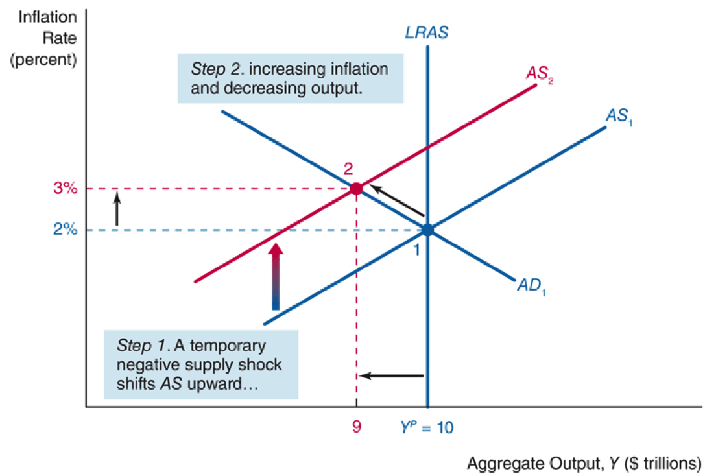

# 21.10.2026 AS and Okuns Law

### Okuns Law

missing Link from

- Inflation <==> Unemployment (Phillips Curve)
- Unemployment <==> Output (Okuns)

Statement: Output and Unemployment = negativvely correlated

- lower Output => higher UE
- lower UE => higher Output
- $U_{gap} = -h Y_{gap}$
  - reponsive ness *h* differs across countries (US high, DE low)

Philipps Curve + Okuns Law: Aggregate Supply Curve

- Output = x-axis
- Inflation = y-axis

$$
\pi = -b U_{gap} + \tilde{\pi} s
$$

underlying inflation $\tilde{\pi}$ 

- partly inflation expecations
- but also backward looking elements (indexation of prices, frictions, ...)

supply shocks s

- e.g  oil shocks etc
- have large aggregate effects on price level

new AS-curve

- Short run: expecations augmented phlipps (can shift!)
- Long Run: vertical (only natural)

