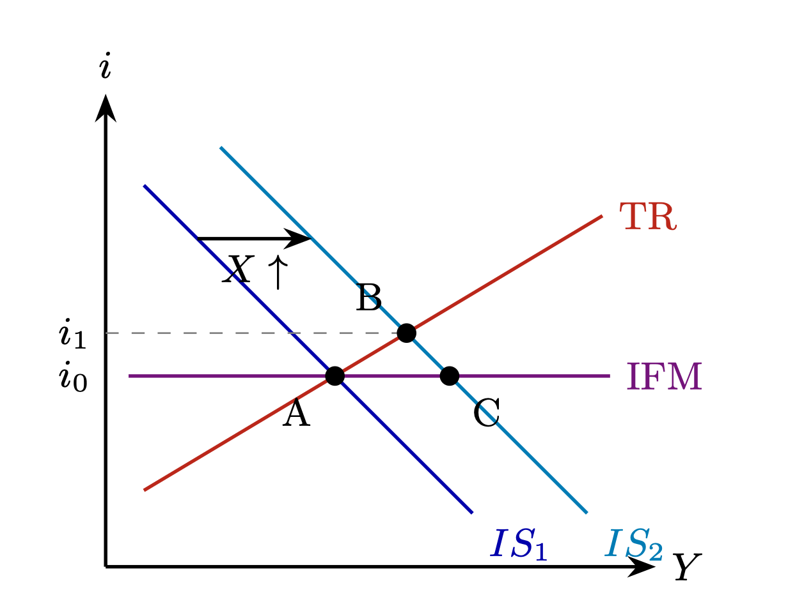
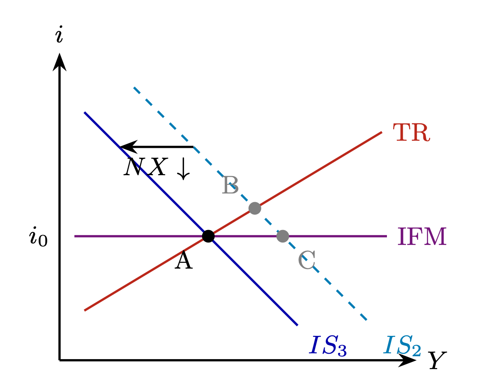
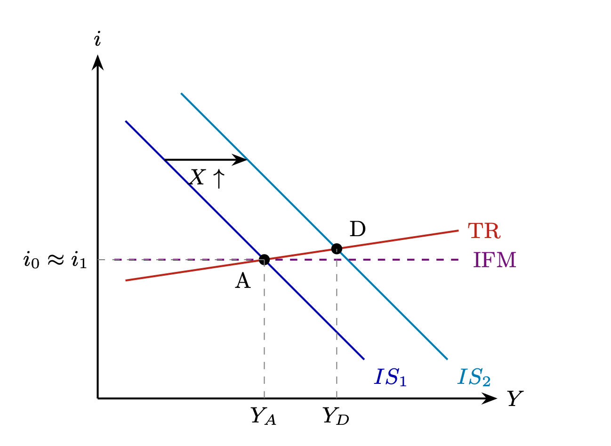

```{=latex}
\begin{titlepage}
      \centering
      \vspace*{2cm}
      {\large Université Paris 1 Panthéon-Sorbonne\par}
      {\normalsize PSME Macroeconomics\par}
      \vspace{2.5cm}
      {\huge\bfseries Macroeconomic commentary\\[0.4em] on the Chinese trade surplus\par}
      \vspace{1.5cm}
      {\large Marten Walk\par}
      \vfill
      \begin{flushleft}
      \renewcommand{\arraystretch}{1.5}
      \begin{tabular}{@{}lp{0.72\textwidth}@{}}
      \textbf{Article:} & China's September exports soar, putting \$1 trillion trade surplus in sight\\
      \textbf{Source:} & \url{https://www.reuters.com/world/asia-pacific/chinas-exports-surge-363-yy-september-imports-up-31-2026-10-14/}\\
      \textbf{Accessed:} & 1 November 2026\\
      \textbf{Published:} & 14 October 2026\\
      \textbf{Word count:} & 967 words\\
      \end{tabular}
      \end{flushleft}
      \vspace{2cm}
    \end{titlepage}
```





```{=latex} 
\clearpage 
```

# Commentary

The chinese trade balance is on track for a record surplus this year. As @zhangChinasSeptemberExports2026 report, it is expected surpass last years record surplus, reaching $938 billion in the nine months of 2026. Driven by global demand for green technology and semiconductors, these exports are set to play a significant role in achieving the anual growth target of 4.5% to 5%.  

But how does the transition from higher exports to output growth work? To answer this question, I will apply the IS-TR model, first setting out its predictions for an export boom and then asking whether China’s experience matches them. 

## A trade shock in the Textbook model

The IS-TR-Mundell-Fleming model (compare @burdaMacroeconomicsEuropeanText2022, ch. 11) extends the standard IS-TR model of a closed economy to include the international financial market (IFM). 

In the model with a floating exchange rate, such as in China [^1], an increase in exports has the following effects (see @fig-A): 

{#fig-A}

[^1]: The IMF refers to the chinese monetary regime as "managed floating exchange rate" [@dasChinasEvolvingExchange2019]

First, it shifts the IS curve to the right ($IS_1 \to IS_2$), as exports form part of the Primary Current Account ($PCA = X-M$). The resulting increase in output widens the output gap, generating inflationary pressures as producers respond to stronger demand by raising prices. A central bank following the Taylor Rule (TR) would then react by increasing interest rates. In Figure 1, this adjustment is represented by the movement from point A to point B along the upward-sloping TR curve. Point C, where IS₂ meets the IFM line, would be reached only if the rate stayed at i₀. Since TR responds, C is unattainable.

At point B, the domestic interest rate is above the IFM Line ($i_1>i_0$). The interest rate differential attracts foreign investment seeking higher returns. To invest in domestic assets, foreign investors must acquire the domestic currency, the renminbi in China's case. The resulting capital inflows put upward pressure on the currency, and cause it to appreciate. This in turn reduces external competitiveness of chinese exports and increase competitiveness of imports ($NX \downarrow$). Consequently, the PCA and desired demand decline, shifting the IS curve back to the left ($IS_2 \to IS_3$). This adjustment continues until the economy returns to its initial equilibrium at point A (see @fig-B).

{#fig-B}

To conclude: an increase in the PCA has no lasting effect on output. In the equilibrium, output is only determined by the intersection of the TR and IFM curves. The growth in exports will ultimately be neutralised by the exchange rate apreciation.

Why, then, does the predicted adjustment not occur in China, which has recorded persistent trade surpluses for more than a decade [^2]?

[^2]: as deomonstrated by @lavenantHowBigChinas2026

## Adapting the model to China

The textbook model rests on several assumptions, two of which are particularly difficult to reconcile with China's economic environment.

First, the model assumes perfect capital mobility and interest rate parity, which are reflected in the horizontal IFM curve. In China, however, capital controls restrict the free movement of capital across borders [@dasChinasEvolvingExchange2019]. Furthermore, China's managed exchange-rate regime allows the authorities to influence the renminbi's value, potentially preventing the appreciation (the article refers to the concerns about competitive currency devaluations). Consequently, the IFM relationship would be less restrictive in practice than the textbook model suggests.

Second, the model assumes that the central bank follows a Taylor Rule. This implies that an increasing output gap generates inflationary pressure, prompting the central bank to raise interest rates. However, this relationship appears weaker in China. The article mentions rising factory-gate prices, but that consumer inflation lagged forecasts, suggesting a limited pass-through of production costs to consumer prices. Moreover, the benchmark Loan Prime Rate of the Peoples Bank of China has remained unchanged for 17 consecutive months [@ChinaSetLeave2026]. This may indicate that the central Bank does not respond to inflationary pressures with a conventional Taylor Rule. 

Together, this could be illustrated by slightly adjusting the diagram in @fig-2. The TR curve is drawn flatter, almost horizontally, to reflect the weaker response of monetary policy to the output gap. The IFM line is represented as a dashed line to indicate that the relationship between domestic and international interest rates is less strict due to capital controls.

{#fig-2}

In this model, following an increase in foreign demand for exports, the IS curve shifts to the right. Since the central bank does not significantly increase interest rates ($i_0 \approx i_1$) and the managed exchange rate limits the usual currency appreciation, the adjustment predicted by the textbook model is weakened. The economy can therefore reach the new point D, close to the previously unattainable point C, where output is higher than at the initial equilibrium A ($Y_D > Y_A$).

However, this figure is purely illustrative. The weakened relationship underlying the IFM line can hardly be represented in the graphic, and the functional form of the Central Bank response might not be linear. Other monetary policy objectives, which are not included in the Taylor Rule, can aslo not be represented in this model. The actual shape of both relationships is therefore more complex than the diagram suggests.

## Conclusion

In conclusion, the IS-TR-Mundell Fleming model predicts that an increase in exports will eventually be offset by currency appreciation, bringing output back to its initial level. However, China's capital controls and distinct monetary policy framework weaken the adjustment mechanisms assumed by the model. This helps explain how China has maintained substantial trade surpluses over recent years, which may persist as foreign demand for Chinese goods remains strong (as analysts cited in @zhangChinasSeptemberExports2026 suggest). Consequently, policymakers in Brussels and Washington cannot expect a natural adjustment to solve their problems with the chinese trade surplus.




## References
