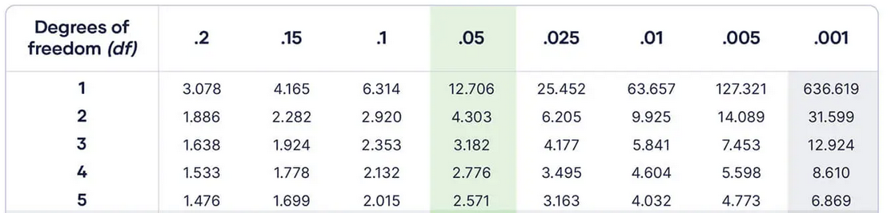
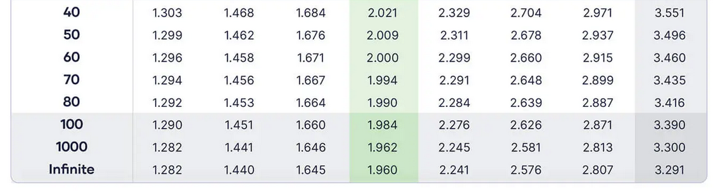
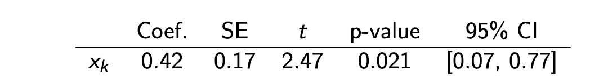
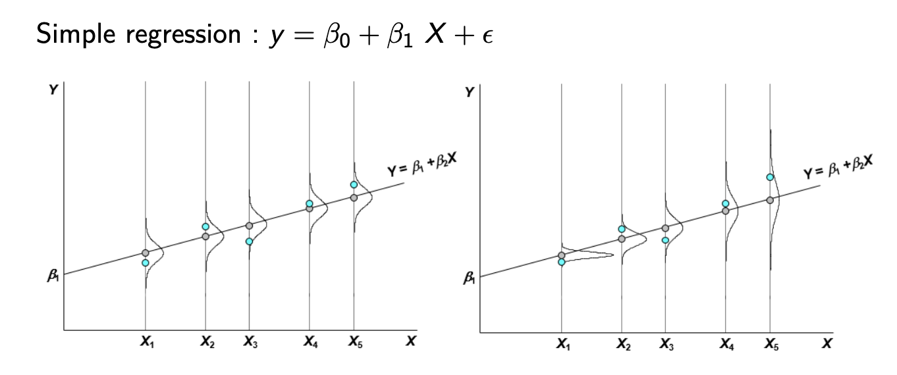
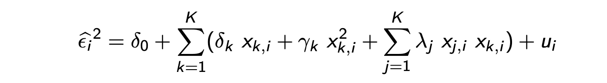

# 15.10.2026 Inference

> **Statistical inference:** $\hat{\beta}_0 \sim \beta_0$?
>
> are coeffients accurate representations of reality? (and to what extent) 


- True population: $y_i = X_i \beta + \epsilon_i$
- Random Sample: $\hat{y} = X_i \hat{\beta} + \hat{\epsilon_i}$


Assumptions:

- **Linear in Parameters (not coefficients!)**: expressable by combining betas
- **Random Sampling**: from true pop
- **No perfect multicollinearity:**  no regressor is combination of others
- **Zero Conditional Mean:** $E(\epsilon_i | X_i) = 0$
  - Errors dont depend on any regressors
  - Implies: $E(\epsilon) = 0$ (Errors are random and zero)
- **homoskedasticity**: $Var(\epsilon_i | X_i) = \sigma^2$
  - Variance of Error is constant across observations
  - "typical error is same for all individuals"
  - e.g. wage ~ income learned:
    - for poor and rich people, average error is 5%
  - often unrealistic


> **Gauss-Markov-Theorem**: under these assumptions, OLS is BLUE (*Best linear unbiased estimator*)


## Standard Errors

= Precision of estimator 

- Standard Deviation = depends on true error 
- Standard Error = computed version from our estimates


$$
SE(\hat{\beta}) = \sqrt{Var(\hat{\beta})}
$$


Which is:

$$
\sqrt{Var(\hat{\beta})} = \sigma^2 (X'X)^{-1} \\
\hat{\sigma}^2 = \frac{1}{n-K-1}\sum \hat{\epsilon}^2_i
$$

> **Whats $(X'X)^{-1}$?** = inverse matrix of regressors. basically a condensed version of the whole data table


For simple Regressions: 

$$
Var(\hat{\beta_1} | X) = \frac{\sigma^2}{\sum_i^n (x_i-\bar{x})^2}
$$

Better (lower) when:

- higher n (larger sample with more information)
- more variation in x
- lower unexplained variation $\sigma^2$


## t-statistic

"Is my sample and coefficient just luck?"

Test $H_0: \beta_k = \beta_{k,0}$ (Null Hypothesis that beta = 0)

Then:

$$
t = \frac{\hat{\beta_k}- \beta_{k,0}}{SE(\hat{\beta_k})}
$$

- Numerator: Distance between estimate and null value
- Denominator: Sampling uncertainty 

t = how many SD is my estimate away from 0? (more = better)

### Students t test

Usual test = $H_0: \beta_k = 0$

$$
\hat{t}_k = \frac{\hat{\beta_k}}{SE(\hat{\beta_k})}
$$

- with $\hat{t}_k = t_{n-K-1}$
- Student distribution of number of degrees of freedom (n-K-1)

Compare with t-table






Recipe: Test $H_0: H_0: \beta_k = 0$ against $H_a: \beta_k \neq 0$

1. Choose significance level alpha (often 5%)
2. Compute df = n-K-1
3. Read the two-sided critical value: $t_{1-a/2,df}$
4. Compare with observed / calculation

$|t_{obs}| > t_{1-a/2,df} \implies$ reject $H_0$ (yayyy)


Note: One sided tests are seldomly used (Two side = default)


### Standard values

for large samples| many degrees of freedom

- 1% confidence: 2.576
- 5% confidence: 1.96
- 10% confidence: 1.645


## P-value

smallest significance value at which $H_0$ would be rejected

- e.g p-value = 0.65
- level below 0.65 = fail to reject $H_0$
- above: easy rejection

"how low can we go?"


## Confidence Intervals

Confidence Intervals for the parameter

> **Explanation:**for 5%: 
>
> if we repeat the sample 100 times, 95 times it would include the true $\beta$

Formula: $\hat{\beta} \pm critival\ value \times SE$

If 0 not in the bound = significant


## Regression Table

In R, or somewhere else:



- Coef: Estimate for $\beta_0$
- SE = Standard Error
- t = Coef / SE
- p value = lowest possible confidence
- CI = confidence intervalle (excludes 0)

**for 5%: all state the same!**


## F-test

Test whether all variables (except $\beta_0$) together = explain variation

- $H_0$: all slopes are null: $\beta_1 = \beta_2 = ... = 0$
- $H_1$: at least one $b_k \neq 0$

Idea: if H0 holds, dropping betas doesnt change R2

$$
F = \frac{R^2_{ur}-R^2_r / q}{(1-R^2_ur)/(n-K-1)}
$$

- ur = unrestricted (with additional vars)
- r = restricted
- q = number of restrictions (different from n, as we can also test a subset of vars)

Intuition

$$
\frac{\text{improvement in fit per restriction}}{\text{unexplained variation per residual df}}
$$

larger = better => reject $H_0$ 


## Heteroskedasticity

Graphic example: Errors depend on regressor

Example: Variation in wages across education

- lower educated = probably earn more in one income band
- probbably errors are larger for higher educated
- e.g bankers and social workers (both highly educated)



### Breusch-Pagan Test

with the Breusch-Pagan Test

1. Estimate original OLS => $\hat{e_i}$
2. Square them => $\hat{e}_i^2$
3. Regress on x => $X \sim \hat{e}^2_i$
4. Test whether slope coefficients are jointly zero  => $\delta_1 = \delta_2 = ...=0$ (-> F-test)

If H0 holds = no relations = homoskedastic


### White Test

fancy BP Test 

- include other functional forms of x (squared)
- and interact with other explanatory vars



BP = White test with $\gamma_k = 0; \lambda_j = 0$


### Correcting HSK with Robust SE

2 options:

- OLS + robust standard errors (white matrix)
- corrected estimator: Generalized Least Squares (GLS)

Focus on Robust SE

- Robust SE = very fancy maths with matrix and sandwich
- use these in all other calculations (except F!)

STATA:

```stata
reg y x1 x2 x3, vce(robust) // Robust SE
estat hettest // BP Test
estat imtest, white // White Test
```

**Note**: Coefficients are identical! only significance will change

